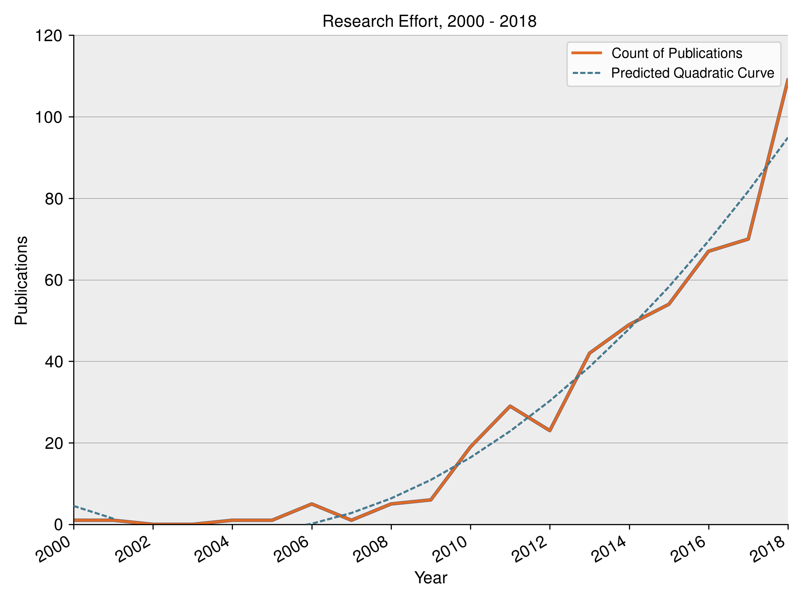

# Introduction

These are the materials comprising the scientometric analysis in [_Public Participation, Engagement and Climate Change Adaptation: A Review of the Research Literature_](https://doi.org/10.1002/wcc.645).

The Python dependencies are declared in [pyproject.toml](pyproject.toml) and locked in [uv.lock](uv.lock). To install them, install [uv](https://docs.astral.sh/uv/), then run this command in the repository root:

```sh
uv sync
```

The original analysis used Python 3.7 and older package versions. The locked versions are more recent, so the output may differ slightly from the published figures.

# Analysis

When you've installed the packages, run `uv run jupyter lab`. The primary analysis is contained in [WIREs.ipynb](WIREs.ipynb). A plaintext version of the dataset, derived from an ISI Web of Science search, can be found at [combined.csv](combined.csv)

# DOI

This analysis has a DOI, and a zipped version of this repository is permanently available at Zenodo:  
[](https://doi.org/10.5281/zenodo.2790803)

# License

All original code in this repository is licensed under the [Blue Oak Model License 1.0](LICENSE.md), and is free to use subject to its terms.

<a href="https://www.scimagojr.com/journalsearch.php?q=19900191605&amp;tip=sid&amp;exact=no" title="SCImago Journal &amp; Country Rank"></a>
